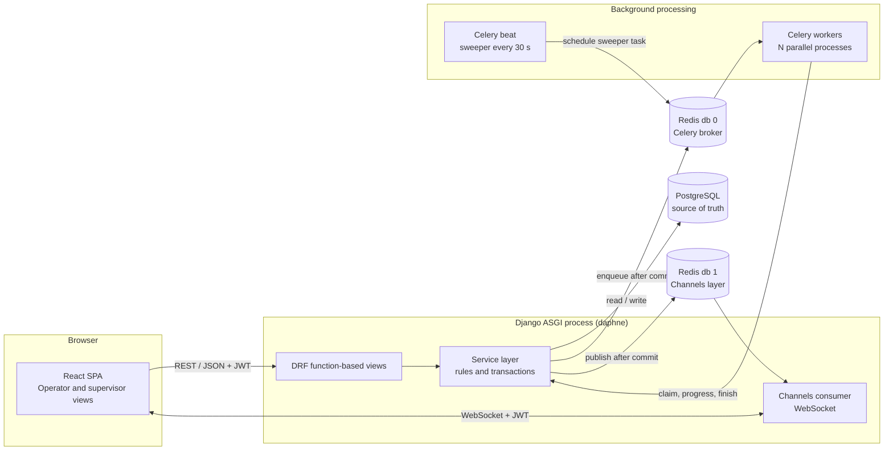
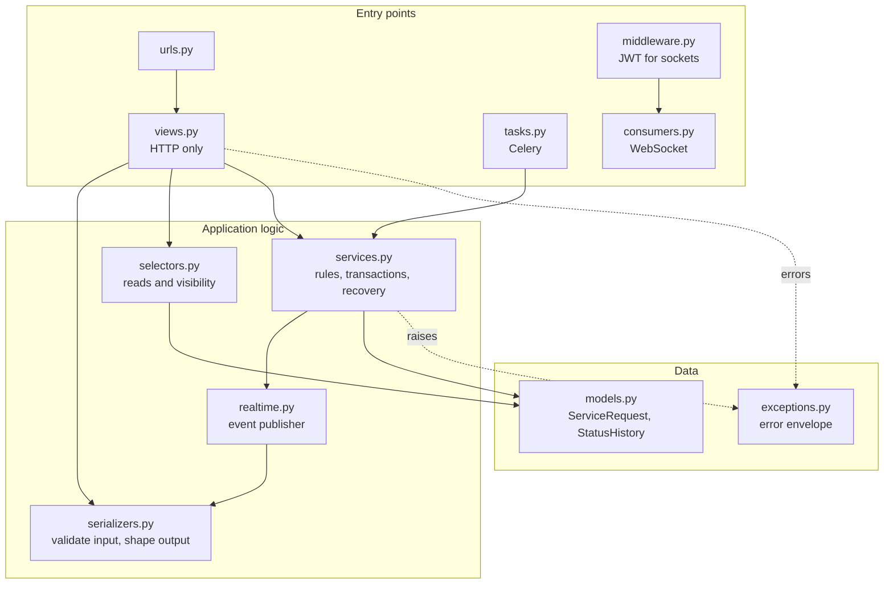
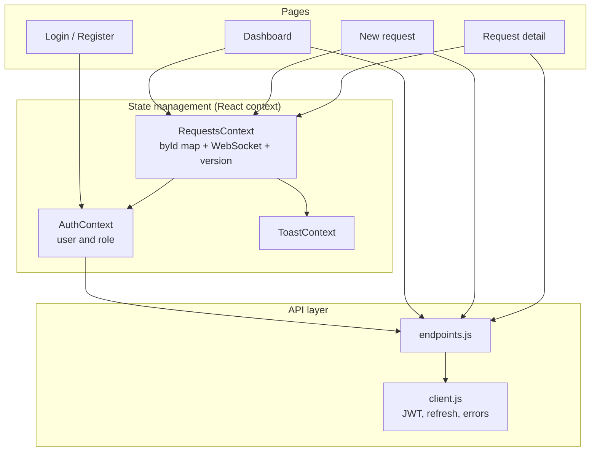
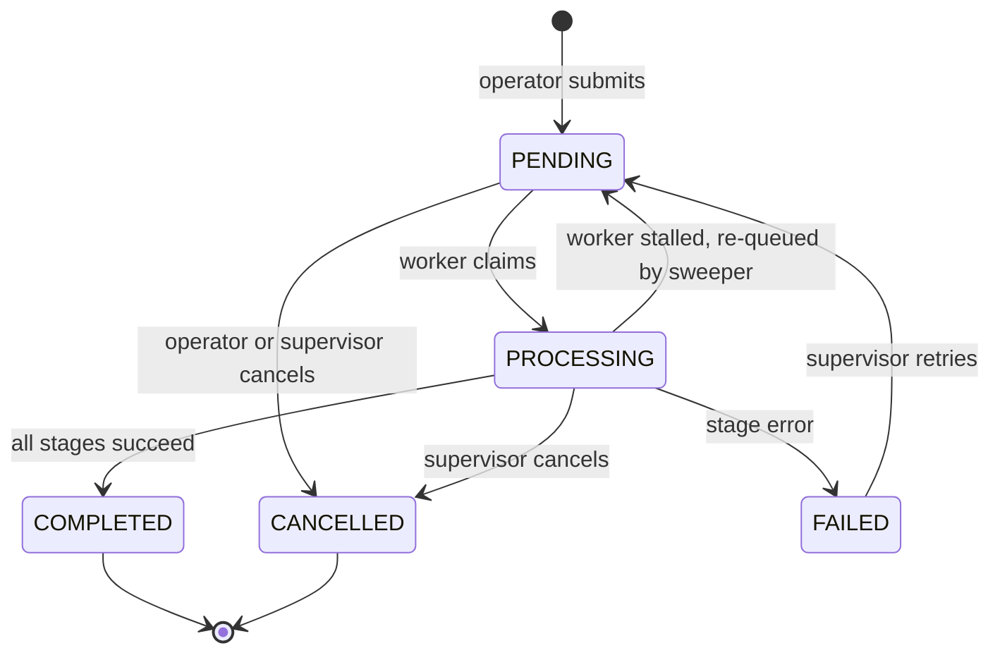
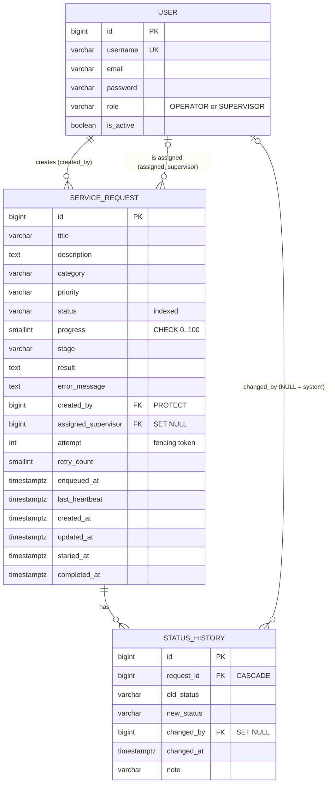
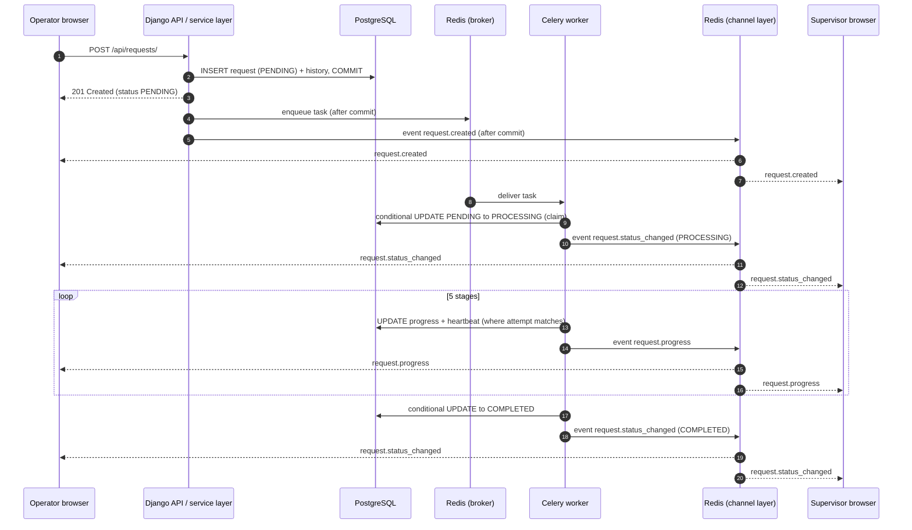

# 2. System Design

**Project:** ServiceDesk, a real-time service request management system
**Deliverable:** System Design (assignment deliverable 2)

The diagrams below are written in [Mermaid](https://mermaid.js.org/) and render automatically on GitHub. To export them as images, paste a diagram into <https://mermaid.live>.

## 2.1 Design principles

1. **The database is the source of truth.** Persist first, publish second. WebSocket events are fast hints; REST can always rebuild the screen.
2. **One job per layer.** Views handle HTTP, serializers validate, selectors read, services change state, tasks are thin entry points.
3. **Never read-then-write shared state.** Workers change state with conditional `UPDATE` statements so the database decides who wins.
4. **Design for failure.** Assume workers die, brokers go down and messages arrive twice.
5. **A modular monolith, not microservices.** One deployable Django codebase is easier to build, test, explain and run for this scope.

## 2.2 High-level architecture

**Reading the diagram.** The browser sends commands over REST and listens over a WebSocket. The service layer is the only code that changes request state, whether the caller is an HTTP view or a Celery worker. After a database commit it queues work (broker) and announces changes (channel layer). Both uses of Redis are logically separate (database 0 and 1).

## 2.3 Component diagram

### Backend modules

| Component | Responsibility | Must not |
|---|---|---|
| `views.py` | Parse HTTP, call a selector or service, return a response | contain business rules |
| `serializers.py` | Validate input; shape output (shared by REST and WebSocket payloads) | change state |
| `selectors.py` | Queries, filters, **role-based visibility** | write data |
| `services.py` | Create, cancel, retry, claim, progress, finish, recover | touch HTTP objects |
| `tasks.py` | Celery entry points that loop over stages and call services | edit model fields directly |
| `realtime.py` | Send event snapshots to per-user channel groups | decide who may act |
| `consumers.py` / `middleware.py` | Accept authenticated sockets, forward group messages | accept commands |

### Frontend modules

## 2.4 Request lifecycle

The allowed transitions are stored as data (`ALLOWED_TRANSITIONS` in `models.py`) and checked in one place. `PENDING` means "accepted but not yet being processed", regardless of whether the task is waiting in Redis or awaiting recovery.

## 2.5 Database design

PostgreSQL, three tables.

**Constraints and relationships**

* `created_by` uses `PROTECT`: a user who has requests cannot be deleted, so ownership is never lost.
* `assigned_supervisor` uses `SET NULL`: removing a supervisor keeps the request.
* `STATUS_HISTORY.request` uses `CASCADE`: history belongs to its request.
* `CHECK (progress BETWEEN 0 AND 100)` is enforced by the database itself.

**Indexes**

| Index | Serves |
|---|---|
| `status` | dashboard filters and counts |
| `(status, last_heartbeat)` | the stalled-job sweeper |
| `(created_by, created_at DESC)` | operator list |
| `(assigned_supervisor, created_at DESC)` | supervisor list |

**Reliability columns.** `attempt` increases on every claim (fencing token). `last_heartbeat` is refreshed on each progress update. `enqueued_at` records when a job was handed to the broker. `retry_count` limits automatic recoveries.

## 2.6 API design

REST over JSON, base path `/api/`, function-based views, JWT bearer authentication. Full details with examples are in [03-api-reference.md](03-api-reference.md).

| Method and path | Purpose | Success |
|---|---|---|
| `POST /auth/register/` | create an operator | 201 |
| `POST /auth/login/` | obtain access and refresh tokens | 200 |
| `POST /auth/refresh/` | renew access token | 200 |
| `GET /auth/me/` | current user | 200 |
| `GET /requests/` | list visible requests (filter, search, sort, paginate) | 200 |
| `POST /requests/` | create a request (operators) | 201 + `Location` |
| `GET /requests/{id}/` | details | 200 |
| `GET /requests/{id}/history/` | status history | 200 |
| `GET /requests/stats/` | counts per status | 200 |
| `POST /requests/{id}/cancel/` | cancel | 200 |
| `POST /requests/{id}/retry/` | retry a failed request (supervisors) | 202 |
| `GET /health/` | liveness | 200 |

**Conventions.** Plural nouns for resources; the HTTP method is the verb; non-CRUD actions are sub-resources (`/cancel/`, `/retry/`). Errors use one envelope (`{"error": {"code", "message", "details"}}`). A request outside the caller's visibility returns **404**, not 403, so its existence is not revealed. Input and output use different serializers so clients cannot write system fields.

## 2.7 WebSocket communication flow

### Endpoint and delivery rules

* URL: `ws://<host>/ws/requests/?token=<access_token>`. Browsers cannot set headers on a WebSocket, so the JWT travels in the query string (access tokens are short-lived, 30 minutes).
* Unauthenticated connections are closed with code **4401**.
* On connect, a user joins the channel group `user_<id>`. Events are sent to the request's creator and its assigned supervisor, which mirrors the REST visibility rules.
* The socket is **receive-only**, plus `{"type": "ping"}` answered with `{"type": "pong"}`. Commands always go through REST.

### Sequence: submit to live update

### Events

| Event `type` | Sent when | Payload |
|---|---|---|
| `connection.ready` | right after a successful connect | `{role}` |
| `request.created` | a request is submitted | `{request}` |
| `request.status_changed` | claim, completion, failure, cancel, retry, recovery | `{request}` |
| `request.progress` | after each processing stage | `{request}` |

`request` is the same object returned by `GET /requests/{id}/`.

### Client behaviour

1. Load current data with REST.
2. Apply events on top (stale events are ignored by comparing `updated_at`).
3. `request.progress` updates the in-memory store only. `request.created` and `request.status_changed` also trigger a debounced REST refresh, because a status change can move a request in or out of the current filter.
4. If the socket closes, reconnect with exponential backoff (1 s, 2 s, 4 s ... up to 15 s) and re-sync from REST when `connection.ready` arrives.

## 2.8 Concurrency model

### Processes

| Process | Role | Scale by |
|---|---|---|
| Web (daphne, ASGI) | REST and WebSockets; never runs long jobs | more instances behind a load balancer |
| Celery worker (prefork) | runs processing tasks in parallel (`--concurrency=N`) | more workers or higher concurrency |
| Celery beat | triggers the recovery sweeper every 30 s | exactly one instance |

All shared state lives in PostgreSQL and Redis. Workers and web processes keep nothing in memory that another needs, so every tier scales horizontally.

### Techniques and what each prevents

| Technique | Where | Prevents |
|---|---|---|
| Background workers | `tasks.py` | blocking API requests during long work |
| `transaction.atomic` | services | half-written state (request without history) |
| `transaction.on_commit` | services | announcing or queueing something that was rolled back |
| Conditional `UPDATE ... WHERE status='PENDING'` | `claim_request` | two workers processing one request (also makes duplicate delivery harmless) |
| Fencing token (`attempt`) in every worker update | `update_progress`, `_finish` | a slow old worker overwriting a newer run |
| `select_for_update()` | cancel, retry, recovery | two people or processes acting on the same row at once |
| Cooperative cancel | progress update returns False | wasting work on a cancelled request |
| `acks_late` + prefetch 1 | Celery settings | losing a job when a worker dies; one worker hoarding jobs |
| Heartbeat + sweeper | `recover_stalled_requests` | requests stuck in PROCESSING or PENDING forever |

### Failure scenarios

| Scenario | What happens |
|---|---|
| Two workers receive the same task | One claim succeeds; the other returns `skipped` |
| Worker dies at 70% | Heartbeat goes stale; after `STALL_TIMEOUT_SECONDS` the sweeper sets the request back to PENDING and re-dispatches it. After `MAX_PROCESSING_RETRIES` it becomes FAILED |
| API commits, then crashes before queueing | Request stays PENDING with `enqueued_at` empty; the sweeper re-dispatches it |
| Broker down at submit time | Request is saved; the failure is logged; sweeper retries on later sweeps |
| Supervisor cancels a running job | Status becomes CANCELLED; the worker's next progress update matches zero rows and the worker stops |
| Redis channel layer down | Events are lost but logged; clients re-sync from REST when they reconnect |
| Old worker wakes up after takeover | Its `attempt` is outdated, so every update is rejected |

## 2.9 Technology stack and justification

| Layer | Choice | Why this one | Alternative considered |
|---|---|---|---|
| Backend framework | Django 5 + Django REST Framework | Batteries included (ORM, auth, admin, migrations); DRF gives validation, pagination, permissions | FastAPI: lighter, but more assembly for auth, admin and migrations |
| View style | Function-based views (`@api_view`) | Everything an endpoint does is visible top to bottom; easy to teach and debug | Class-based viewsets: less code, more indirection |
| Database | PostgreSQL | Row locking, constraints, partial/compound indexes, strong concurrency semantics | SQLite: no real concurrent writers (used only for tests) |
| Background work | Celery + Redis | Standard, supports retries, scheduling (beat), `acks_late`, many workers | Threads (shared-process, no crash isolation); asyncio tasks (die with the web process) |
| Real-time | Django Channels + Redis channel layer | Native Django integration, shared auth, group broadcast across processes | Server-Sent Events (one-way only); a separate Node service (extra system to run) |
| Auth | JWT (simplejwt) | Works for both REST and WebSocket; stateless | Session cookies: awkward for WebSockets and separate-origin SPAs |
| Frontend | React 18 + Vite + React Router | Component model suits live-updating lists; fast dev server | Next.js: server rendering is unnecessary here |
| Frontend state | React Context + `useReducer` | Small app, no extra dependency, shows the reducer pattern clearly | Redux Toolkit / Zustand: more power than needed |
| Containers | Docker Compose for PostgreSQL and Redis | One command for infrastructure | Manual installs |
| Testing | Django `TestCase` / `APITestCase`, Channels `WebsocketCommunicator` | Built-in, no extra tools | pytest-django |

## 2.10 Security design

* **Authentication:** JWT access token (30 min) and refresh token (1 day); WebSocket authenticates with the same token.
* **Authorisation on the server:** every query starts from `visible_requests(user)`; services re-check actor rules; the UI hides buttons only for convenience.
* **Mass assignment:** write serializers list only `title`, `description`, `category`, `priority`.
* **Information leakage:** hidden requests return 404.
* **Registration:** public registration can only create operators.
* **Secrets:** read from the environment, never committed; `.env.example` is committed with placeholders.
* **CORS:** explicit origin allow-list.
* **Passwords:** Django's PBKDF2 hashing and password validators.
* **Known trade-off:** the WebSocket token is in the URL and could appear in access logs, which is why access tokens are short-lived and query strings should not be logged.

## 2.11 Key decisions and trade-offs

| Decision | Benefit | Cost |
|---|---|---|
| Worker owns the lifecycle; supervisors oversee | No contradictory states; humans cannot mark unfinished work complete | Real field work would need a technician or supervisor confirmation step |
| Sweeper instead of transactional outbox | Much simpler | Recovery delay up to the sweep interval; duplicates are possible but harmless |
| WebSocket as hint, REST as truth | Simple, robust reconnect | An extra REST fetch after relevant events |
| Auto-assignment by lowest load | Fair and predictable | Can be slightly unbalanced under a race (balance only, never correctness) |
| Modular monolith | One thing to build and run | Components scale together unless split later |
| Priority does not reorder the queue | Keeps the broker simple | Urgent requests wait their turn |

## 2.12 Limitations and future work

* Replace the sweeper with a **transactional outbox** for guaranteed hand-off.
* Real processing integration or technician confirmation instead of the simulated stages.
* Priority queues (separate queues per priority) and workers dedicated to them.
* Supervisor reassignment, load balancing by skill, notifications (email or SMS).
* Rate limiting, audit export, structured JSON logging, metrics and tracing.
* CI/CD pipeline and cloud deployment.
